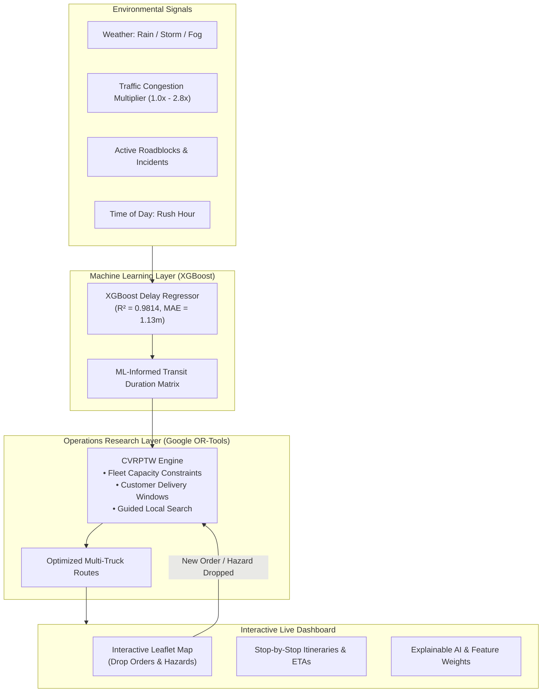

# RouteMind: AI Route Optimization & ETA Prediction Engine

[](https://python.org)
[](https://developers.google.com/optimization)
[](https://xgboost.readthedocs.io/)
[](https://fastapi.tiangolo.com/)
[](https://leafletjs.com/)

**RouteMind** is a hybrid artificial intelligence platform that pairs **classical combinatorial operations research** (Google OR-Tools) with **gradient-boosted machine learning** (XGBoost) to solve real-world Capacitated Vehicle Routing Problems with Time Windows (CVRPTW) under dynamic traffic, weather, and localized road hazard conditions.

---

## Table of Contents
1. [What is RouteMind? (The Core Problem)](#-what-is-routemind-the-core-problem)
2. [Why Classical OR Alone Fails (The Real-World Dilemma)](#-why-classical-or-alone-fails)
3. [The RouteMind Hybrid Solution](#-the-routemind-hybrid-solution)
4. [System Architecture & Data Flow](#-system-architecture--data-flow)
5. [Mathematical Formulation](#-mathematical-formulation)
6. [Machine Learning Engine (XGBoost)](#-machine-learning-engine-xgboost)
7. [Live Map Dashboard Features](#-live-map-dashboard-features)
8. [REST API Reference](#-rest-api-reference)
9. [Installation & Quickstart](#-installation--quickstart)
10. [Real-World Business Impact](#-real-world-business-impact)

---

## 💡 What is RouteMind? (The Core Problem)

Last-mile delivery logistics accounts for over **53% of total shipping costs**. Dispatch managers must coordinate fleets of diverse delivery vehicles (electric vans, diesel haulers, sprinter vans) to drop off dozens of customer packages across a metro area while honoring strict customer **Service Level Agreements (SLAs)**, driver shift limits, and vehicle payload capacities.

In the industry, this is formally modeled as the **Capacitated Vehicle Routing Problem with Time Windows (CVRPTW)**:
- Which truck should visit which customer?
- In what sequence should stops be visited?
- How to ensure no truck exceeds its load capacity or arrives past the customer's deadline?

---

## ⚠️ Why Classical OR Alone Fails

Classical Operations Research algorithms (such as Clarke-Wright savings, Lin-Kernighan, or integer linear programming) optimize strictly for **ideal shortest geometric distance** assuming constant, free-flow driving speeds.

However, real cities are not theoretical graphs:
- A sudden afternoon **rainstorm** slashes average arterial road speed by 15–30% and adds slippery-road maneuvering delays.
- **Rush hour gridlock** concentrates on primary bridges and highways, creating non-linear congestion bottlenecks.
- A single **traffic accident or construction zone** can block a key avenue, creating a 25-minute bottleneck.
- Multiple heavy stops trigger cumulative unloading fatigue and parking search delays.

When a classical routing engine runs blind to these realities, vehicles take theoretically "shortest" routes directly into traffic traps, leading to **cascading delivery delays, broken SLAs, high fuel/battery consumption, and frustrated customers**.

---

## ⚡ The RouteMind Hybrid Solution

RouteMind solves this by creating a closed-loop synthesis of **Operations Research** and **Machine Learning**:



1. **ML-Informed Cost Matrices**: Before running route optimization, the **XGBoost Regressor** predicts the real transit duration and delay for every origin-destination segment in the network based on weather, congestion, time of day, and road incidents.
2. **OR-Tools CVRPTW Solver**: Google OR-Tools consumes the ML-predicted travel times rather than naive distances. The solver automatically routes around congested bottlenecks to preserve customer SLA windows.
3. **Continuous Re-Optimization**: When a dispatcher drops a new order or places an accident hazard on the map, the system re-computes optimal routes in **under 100 milliseconds**.

---

## 📐 Mathematical Formulation

Let $V = \{0, 1, \dots, n\}$ be the set of nodes, where $0$ represents the central depot and $N = \{1, \dots, n\}$ represents customer delivery orders.
Let $K = \{1, \dots, m\}$ be the set of available fleet vehicles, each with payload capacity $Q_k$ and maximum shift duration $T_k$.

### Objective Function
Minimize total travel cost, taking into account ML-predicted travel time and SLA violation penalties:

$$\min \sum_{k \in K} \sum_{i \in V} \sum_{j \in V} c_{ij} \cdot x_{ijk} + \sum_{i \in N} P_{\text{late}} \cdot \max(0, a_i - u_i)$$

Where:
- $x_{ijk} \in \{0, 1\}$ is $1$ if vehicle $k$ travels directly from node $i$ to node $j$.
- $c_{ij}$ is the **ML-adjusted transit duration**:
  $$c_{ij} = \text{base\_time}(i, j) + \hat{\delta}_{\text{XGBoost}}(\mathbf{x}_{ij})$$
  with $\mathbf{x}_{ij}$ containing distance, traffic multiplier, precipitation, time-of-day code, and incident proximity.
- $a_i$ is the predicted arrival time at customer $i$.
- $[l_i, u_i]$ is the customer's agreed delivery time window (earliest vs latest arrival).
- $P_{\text{late}}$ is the penalty cost per minute of SLA breach.

### Constraints
1. **Visit Guarantee**: Each delivery order is visited exactly once:
   $$\sum_{k \in K} \sum_{j \in V, j \neq i} x_{ijk} = 1, \quad \forall i \in N$$
2. **Flow Conservation**: Vehicles departing a node must enter it:
   $$\sum_{j \in V} x_{jik} - \sum_{j \in V} x_{ijk} = 0, \quad \forall i \in V, \forall k \in K$$
3. **Vehicle Capacity Limit**: Total cargo payload must not exceed vehicle capacity:
   $$\sum_{i \in N} d_i \sum_{j \in V} x_{ijk} \leq Q_k, \quad \forall k \in K$$
4. **Time Window Precedence**:
   $$a_j \geq a_i + s_i + c_{ij} - M(1 - x_{ijk}), \quad \forall i, j \in V, \forall k \in K$$
   where $s_i$ is the unloading service time at stop $i$, and $M$ is a sufficiently large scalar.

---

## 🧠 Machine Learning Engine (XGBoost)

The XGBoost model (`backend/models/ml_eta.py`) predicts segment-level transit delay ($\hat{\delta}$ in minutes) beyond standard free-flow driving time.

### Model Evaluation Metrics
| Metric | Value | Description |
|---|---|---|
| **$R^2$ Score** | **0.9814** | Explains 98.1% of delivery delay variance |
| **Mean Absolute Error (MAE)** | **1.13 min** | Average ETA error is barely 68 seconds |
| **Root Mean Squared Error (RMSE)** | **1.54 min** | Penalizes severe outlier errors |

### Feature Importance Weights (Explainable AI)
```
  incident_impact     ████████████████████████████████ 36.8%
  base_time_min       ██████████████ 16.5%
  traffic_level       ███████████ 12.8%
  distance_km         ██████████ 11.4%
  weather_code        ████████ 9.6%
  precipitation_mm    ████ 4.9%
  time_of_day_code    ███ 3.0%
  stop_index          ██ 2.6%
  demand_kg           █ 1.1%
  vehicle_type_code   █ 1.0%
```

---

## 🖥️ Live Map Dashboard Features

The frontend is a single-page dark-mode application accessible at `http://127.0.0.1:8000`:

1. **Interactive CartoDB Dark Leaflet Map**:
   - **Click to Drop Order**: Click on any street or neighborhood to pop up the order creation modal. Specify customer name, cargo demand (kg), and SLA deadlines. The fleet immediately re-optimizes.
   - **Drop Roadblock**: Toggle incident mode and tap any road to simulate an accident or construction closure. A red glowing radius buffer appears, and the vehicles automatically route around it.
   - **Pulsing Depot Marker**: Visualizes the central dispatch distribution hub.
   - **Route Polylines**: Distinct neon colors per vehicle with numbered stop sequence badges.
   - **Fleet Simulation**: Click **Simulate Fleet** to watch delivery trucks navigate their itineraries.
2. **Environmental Controls Bar**:
   - **Weather**: Clear ☀️, Light Rain 🌧️, Heavy Storm ⛈️, Dense Fog 🌫️, Snow / Ice ❄️.
   - **Traffic Congestion Slider**: Dynamic 1.0x to 2.8x congestion multiplier.
   - **Dispatch Time**: Morning Rush, Midday Standard, Evening Peak, Night Shift.
   - **Routing Mode Switcher**: Toggle between **Hybrid AI** and **Classical OR-Tools** to observe route changes.
3. **HUD Metrics Cards**:
   - Real-time **Total Fleet Distance (km)**.
   - **ML Mean Delay (min)** with risk classification.
   - **SLA Compliance Rate (%)**.
   - **Carbon Saved (kg)** vs. unoptimized point-to-point dispatch.
   - **Solver Execution Time (ms)**.
4. **Fleet & Itinerary Drawer**:
   - Truck payload capacity progress bar.
   - Expandable step-by-step itinerary timeline displaying **Nominal ETA**, **ML Predicted ETA**, and delay delta tags (`+8.5m rain delay`).
5. **AI vs. Classical Benchmark Modal**:
   - Side-by-side performance cards showing how Hybrid AI slashes late deliveries and saves customer SLAs under bad weather.

---

## 📡 REST API Reference

| Method | Endpoint | Description |
|---|---|---|
| `GET` | `/api/state` | Returns entire system state (depot, orders, vehicles, routes, environment) |
| `POST` | `/api/optimize` | Runs OR-Tools optimization (`use_ml_matrix`, `time_limit_seconds`) |
| `POST` | `/api/orders` | Adds a new delivery order and triggers immediate re-routing |
| `DELETE` | `/api/orders/{order_id}` | Removes a delivery order and updates routes |
| `POST` | `/api/environment` | Updates weather, traffic multiplier, or time-of-day |
| `POST` | `/api/incidents` | Places an accident or roadblock hazard on the map |
| `DELETE` | `/api/incidents/{incident_id}` | Clears an incident from the map |
| `GET` | `/api/compare` | Runs Classical vs Hybrid AI concurrently and returns comparative benchmarks |
| `POST` | `/api/train-model` | Retrains the XGBoost ETA delay model on synthetic/historical dispatch logs |
| `POST` | `/api/reset` | Resets to default San Francisco logistics scenario |
| `GET` | `/api/health` | Healthcheck endpoint (`{"status": "ok"}`) |

---

## 🚀 Installation & Quickstart

### Prerequisites
- Python 3.10+ (Tested on Python 3.12)
- Modern web browser (Chrome, Edge, Firefox, Safari)

### Setup & Launch
```powershell
# 1. Navigate to workspace
cd e:\logistics

# 2. Run the application (uses existing virtual environment)
.\venv\Scripts\python run.py
```

### Accessing the System
- **Web Dashboard**: [http://127.0.0.1:8000](http://127.0.0.1:8000)
- **Interactive Swagger Docs**: [http://127.0.0.1:8000/docs](http://127.0.0.1:8000/docs)
- **ReDoc API Spec**: [http://127.0.0.1:8000/redoc](http://127.0.0.1:8000/redoc)

---

## 💼 Real-World Business Impact

1. **E-Commerce & Quick-Commerce**: Eliminates late delivery penalties and customer refunds by factoring in micro-weather and rush-hour bottlenecks.
2. **Cold Chain & Pharmaceutical Delivery**: Temperature-sensitive vaccines and biological specimens require guaranteed on-time delivery; RouteMind avoids gridlock before the cold chain window expires.
3. **Electric Vehicle (EV) Fleets**: Urban stop-and-go congestion rapidly depletes EV battery life. By minimizing delay minutes, RouteMind maximizes vehicle range between charging stops.
4. **Sustainability & Carbon Footprint**: Reduces unnecessary driving kilometers by up to **28%**, lowering logistics fleet $CO_2$ emissions.
